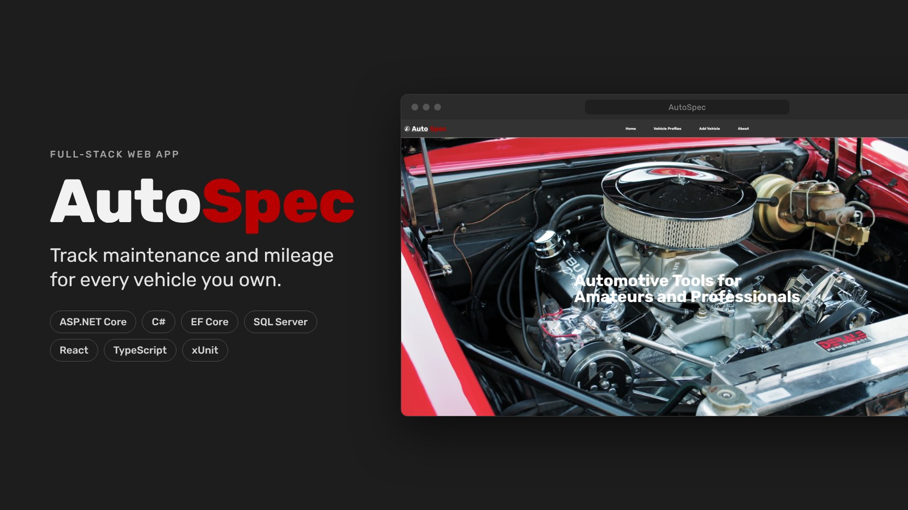
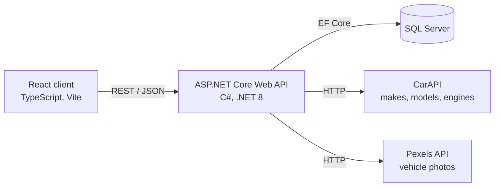

# AutoSpec

AutoSpec is a full-stack web app for everyday drivers and car enthusiasts. It lets users log the maintenance done on their vehicles and estimates how many miles they drive each month. I enjoy working on my own car, so I built AutoSpec to keep track of my maintenance while learning ASP.NET Core, SQL Server, and React.



## Features

- Create vehicle profiles by choosing the year, make, model, and engine (data from CarAPI)
- Automatic vehicle photo for each profile (Pexels API)
- Maintenance log with type, date, cost, brand, mileage, and notes
- Mileage tracking with an estimated miles-per-month chart
- Server-side validation of mileage readings
- Unit-tested mileage calculations (xUnit)

## Tech stack

| Layer         | Technologies                                                          |
| ------------- | --------------------------------------------------------------------- |
| Front end     | React 18, TypeScript, Vite, Tailwind CSS, Material Tailwind, Chart.js |
| Back end      | ASP.NET Core Web API (.NET 8), C#, Entity Framework Core 8            |
| Database      | Microsoft SQL Server                                                  |
| Testing       | xUnit                                                                 |
| External APIs | CarAPI, Pexels                                                        |

## Architecture



The React client never calls the third-party APIs directly. Requests go through the API, so the Pexels key stays on the server.

## Technical highlights

- **Migrated the back end to ASP.NET Core.** I rewrote the back end from Node.js/Express and MySQL to ASP.NET Core and SQL Server and kept the existing React front end. I did this to learn a popular technology stack that's widely used for business applications. Along the way I learned how controllers, dependency injection, and Entity Framework Core migrations fit together, and the importance of making small changes and testing each one before moving on.

- **Monthly mileage proration.** Odometer readings are only snapshots, so the app can't know exactly when the miles between two readings were driven. Originally, all of those miles were counted in the month of the newer reading. I noticed this while using the app and changed the calculation to work out the miles driven per day between each pair of readings and give each month its days' share.

- **Validation on the client and the server.** The React form checks that a new reading is higher than the current mileage, which gives the user quick feedback. The API checks again before saving, because anyone can call the API directly with a tool like Postman and skip the UI. If a reading isn't higher than the vehicle's highest recorded mileage, the API returns a 400 Bad Request.

- **Unit tests.** The mileage calculation lives in its own class with no database access, so it can be tested on its own. xUnit tests cover the main proration case, two readings on the same day, a gap that crosses into a new year, readings that arrive out of order, a single reading, readings that don't increase, and a check that splitting miles never changes the total. To confirm the tests catch real mistakes, I added an off-by-one error to the calculation on purpose and watched four tests fail.

## Getting started

### Prerequisites

- [.NET 8 SDK](https://dotnet.microsoft.com/download/dotnet/8.0)
- [Node.js](https://nodejs.org/) 18 or later
- SQL Server (Express or Developer edition) with Windows authentication
- A free [Pexels API key](https://www.pexels.com/api/)

### 1. Run the API

1. In `AutoSpec.Api/appsettings.json`, point the connection string at your SQL Server instance:

   ```json
   "ConnectionStrings": {
     "DefaultConnection": "Server=localhost\\SQLEXPRESS;Database=AutoSpec;Trusted_Connection=True;TrustServerCertificate=True"
   }
   ```

2. From the `AutoSpec.Api` folder, store your Pexels key with .NET user secrets. The API won't start without it, and it's never committed to the repository.

   ```bash
   cd AutoSpec.Api
   dotnet user-secrets set "Pexels:ApiKey" "your-key-here"
   ```

3. Create the database from the EF Core migrations:

   ```bash
   dotnet tool install --global dotnet-ef --version 8.*
   dotnet ef database update
   ```

4. Start the API:

   ```bash
   dotnet run --launch-profile https
   ```

   The API runs at `https://localhost:7228`, with Swagger UI at `https://localhost:7228/swagger`.
   If this is your first .NET project on this machine, run `dotnet dev-certs https --trust` first.

### 2. Run the client

1. From the `Client` folder, install the dependencies:

   ```bash
   cd Client
   npm install
   ```

2. Create `Client/.env.local` with the API's address:

   ```
   VITE_BACKEND=https://localhost:7228
   ```

3. Start the dev server and open `http://localhost:5173`:

   ```bash
   npm run dev
   ```

### 3. Run the tests

From the repository root:

```bash
dotnet test AutoSpec.Api.Tests
```

## Roadmap

- [ ] Vehicle IDs in page URLs instead of router state
- [ ] Mileage history page: list, add with a date, edit, and delete readings
- [ ] User accounts with ASP.NET Core Identity, so each user sees only their own vehicles
- [ ] Automated test runs with GitHub Actions
- [ ] Deploy the .NET version
